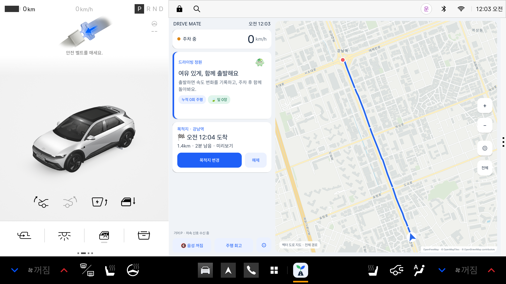
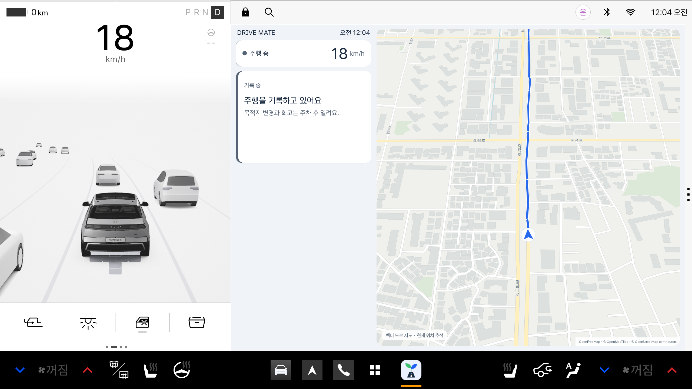
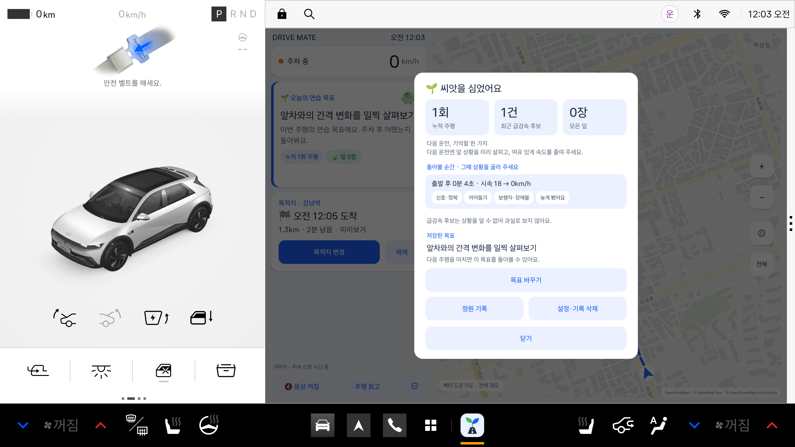
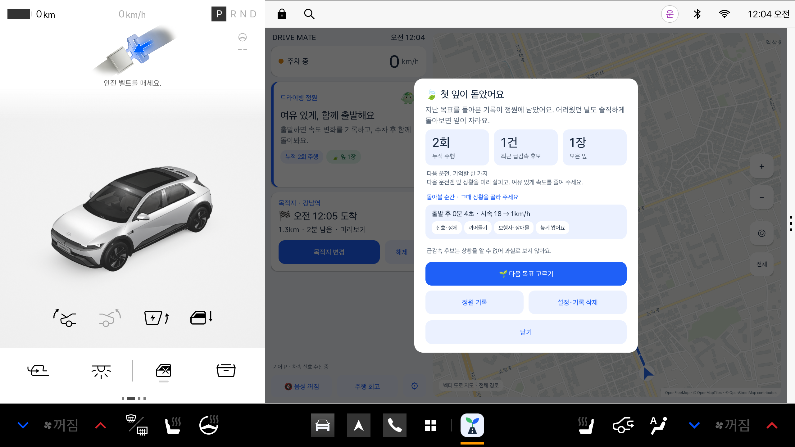
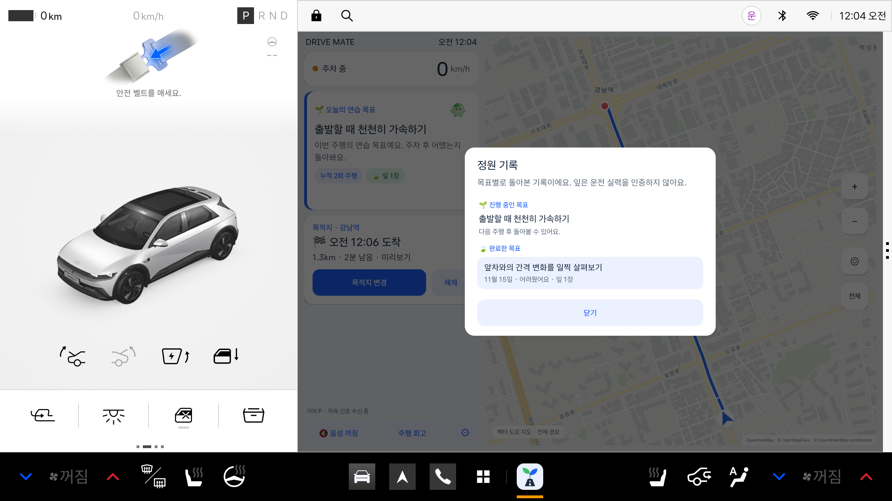
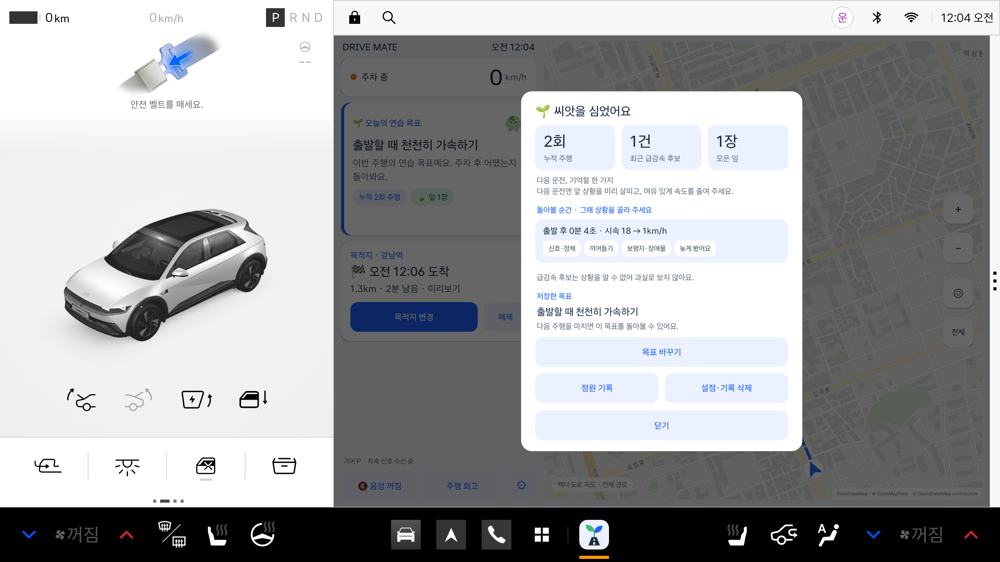
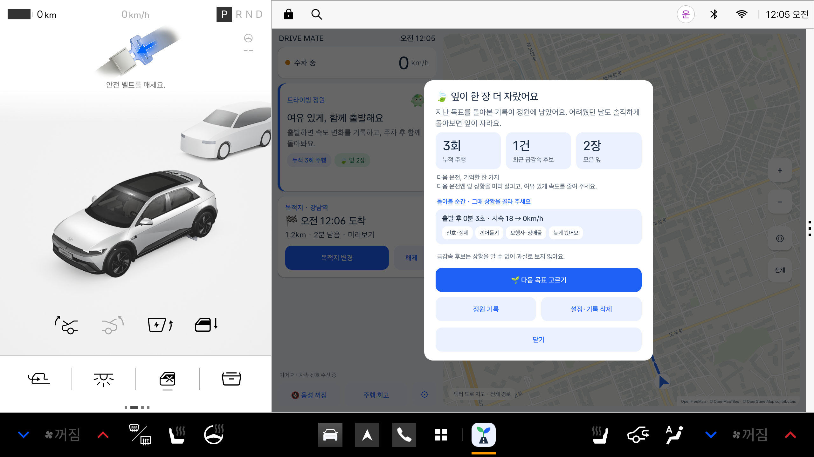

# 제출 release 검증 기록

검증일: 2026-11-14~15 KST. 원본 AVD의 사용자 데이터를 보존하기 위해 `DriveMate_Pleos_API34 -read-only -no-snapshot` 환경에서 새 설치했습니다. 아래 화면 7장은 최종 서명 release APK에서 처음 설치 상태부터 목표·주행·회고·잎 보상을 재검증한 실제 화면입니다. 모의 차량 신호·GPS로 검증했습니다. 앱의 목표·잎·주행 저장값을 직접 수정하지 않았습니다.

## 대상과 결과

- APK: `apk/TeamGreenlight_DRIVE_MATE_release.apk` / 0.1.0(1).
- SHA-256: `bd568b411ba0bc5b98a10d50252140842464295d95e726cd15384a33bdd4c3d8`.
- 빌드 출력·저장소 파일·최종 설치된 base APK의 SHA-256이 일치합니다.
- release manifest에 application-debuggable 없음. apksigner 서명 검증 통과.
- 인증서 SHA-256: `7f20f5be3eabe812195e63ad173bfddca9119845efe01fe96c262a6c68798760`.
- Pleos `release_connect_v2.1.0` / Android 14 API34 x86_64 / 2560×1440.

| 확인 | 결과 |
|---|---|
| `assembleRelease`, `assembleReleaseAndroidTest` | 성공 |
| `testReleaseUnitTest` | 52개 통과 / 실패·오류·건너뜀 0 |
| `lintRelease` | 오류·Fatal 0 / 경고 127. 경고 전체를 해소한 상태는 아님 |
| 실제 release 기기 계측 테스트 | 4개 통과: 설정·출처, 기록 중지·재개, 전체 삭제 후 재실행, Pleos ON_DEVICE STT |
| Python GPS / 샘플 도구 테스트 | 각각 3개 / 2개 통과 |
| 설치·현재 위치·강남역 도로 경로 | 화면 확인. 양재역→강남역 약1.6km 미리보기 |
| D단·차속 기록 / 상세 입력 제한 / P단 회고 | 모의 차량 신호로 확인 |
| 목표→새 주행→어려웠어요→첫 잎 | 주행1회에서 목표 저장 → 2회 후 응답 → 잎0→1 확인 |
| 다음 목표·정원 기록 | 완료 목표와 어려웠어요 응답, 새 목표 함께 표시 |
| 주차 중 force-stop 후 재실행 | 주행2회·잎1장·다음 목표 유지. 불필요한 세션 증가 없음 |
| 제출 GPS 도구 | release 고정 좌표 모드 실행, 실제 경로1644m 로딩·18m 진행·P단 정지 확인 |

계측 테스트 첫 실행에서 오래된 지도 출처 문자열과 스크롤 누락 때문에 설정 테스트가 실패했습니다. 현재 벡터 지도 출처·스크롤 동작에 맞춰 테스트를 수정한 뒤 **4개 전체를 재실행해 통과**했습니다. [원본 결과](instrumentation-results.txt)

## 실제 화면

### 현재 위치와 도로 경로

### 주행 중 차량 신호와 입력 제한

### 목표 저장 후 씨앗

### 어려웠어요 응답 후 첫 잎

### 완료한 회고와 다음 목표

### 주차 상태 프로세스 재시작 후 보존

## 해석의 한계

- STT 테스트는 테스트용 한국어 PCM을 실제 Pleos 엔진에 전달한 결과이며 실제 마이크 녹음·실차 소음 검증이 아닙니다.
- 실제 차량의 신호 지원·권한·안전벨트 경고 정확도와 주행 중 음성 사용 적합성은 별도 확인이 필요합니다.
- 주차 중 프로세스 재실행만 확인했습니다. 기기 재부팅, 앱 강제 중지·전원 종료 동안 연속 수집을 보장하지 않습니다.
- 모의 속도·GPS 검증은 실도로 주행이나 안전 성능 인증, 장기 사용자 습관 개선 검증이 아닙니다.
- 지도·검색·경로는 외부 네트워크 서비스에 의존합니다. 콘솔 브라우저가 비활성화되면 모의 신호도 정지할 수 있습니다.
- 잎3장 화분 선택·5장 정원 확장 및 학원·가족·렌터카 연계는 향후 계획입니다.

## 최종 재검토

두 번째 보상에서도 첫 잎이라고 나오던 제목과 회고 안내를 첫 보상·추가 보상으로 구분했습니다. 목표·잎 누적 규칙은 유지했습니다. 업데이트 설치 후 주행3회·잎2장 보존 및 `잎이 한 장 더 자랐어요` 표시를 확인했습니다.

감속 후보 뒤 재가속·재감속하면 종료 속도가 높아져 감속이 아닌 것처럼 표시되던 오류도 수정했습니다. 한 감속 구간의 최저 관찰 속도를 유지하며 재가속·연속 제동 회귀 테스트2개를 추가했습니다. 최종 UI에서 18→1km/h, 18→0km/h의 유효한 감속 표시와 잎0→1→2, 주차 재실행 보존을 확인했습니다.
